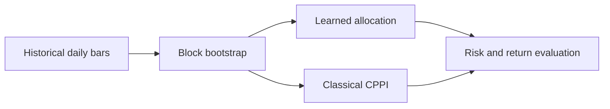

<p align="center"></p>

[](https://github.com/FaiyazEnayet/neural-cppi/actions/workflows/ci.yml)
[](https://hub.xerj.org/contributors/FaiyazEnayet) [](LICENSE)   [](https://faiyazenayet.github.io/neural-cppi/docs/dashboard.html)

<p align="center"><a href="https://faiyazenayet.github.io/neural-cppi/docs/dashboard.html"><b>Open interactive demo</b></a> · <a href="#method">Method</a> · <a href="#run-locally">Run locally</a></p>

# Neural-CPPI

A research implementation of neural portfolio insurance. It compares learned allocation policies with classical CPPI and makes the trade between terminal wealth and floor protection inspectable.


[](https://faiyazenayet.github.io/neural-cppi/docs/dashboard.html)


The dashboard separates return-seeking behavior from protection outcomes. Read the wealth comparison together with breach frequency, horizon and allocation policy: a stronger average result can still carry undesirable tail risk. The regime summaries provide a second check on whether conclusions depend on a particular return environment.

## Explore

- Compare wealth bands with the protection floor across source horizons and classical multipliers.
- Inspect learned allocation at different floor levels, then read the corresponding experimental tables.
- Review transaction-cost assumptions, drawdown constraints and cross-regime evidence alongside returns.

## Method

Historical daily returns generate block-bootstrap scenarios. A neural policy learns risky allocation or a long-only multi-asset mix. Evaluation separates synthetic experiments, resampled market paths and held-out regime tests.

## Evidence at a glance

| Scope | Recorded result or contract |
| :--- | :--- |
| 63-day synthetic learned-policy experiment | Mean terminal wealth 101.70 from initial wealth 100 |
| Same experiment | Terminal wealth standard deviation 3.63; observed terminal-floor breaches 0.3% |
| Interpretation | Finite-sample outcomes, not a capital-protection guarantee |

## Updating this project

Dashboard source language: **Python**. Generator: `scripts/make_dashboard.py`. The local interactive output is `docs/dashboard.html`.

## Run locally


```sh
python -m pip install -e ".[dev]"
python -m pip install -r portfolio_ui/requirements.txt
python -m pytest tests -q
python -m dhl.experiments.cppi_learned
python -m dhl.experiments.cppi_multi
python scripts/make_dashboard.py
```

## Technical design

The single-asset policy uses time remaining, cushion and volatility to choose risky exposure. The multi-asset version uses long-only portfolio weights and a drawdown-sensitive floor. A safety layer can cap total risky exposure while the learned policy chooses the asset mix. These are distinct experimental variants, so their results should not be combined into one headline return.



## Evaluation protocol

The committed dashboard contains separate synthetic experiments, a historical-return bootstrap explorer and historical regime summaries. The bootstrap bands describe resampled scenarios, not a realized investment track record. Floor-breach rates must be read with the horizon, path count, transaction-cost assumptions and exact floor definition.


The illustrated 63-day experiment improves mean wealth over the classical policies while accepting some terminal-floor breaches. That is an observed tradeoff. It does not establish that the learned policy dominates CPPI in every market.

## Code and data

`src/dhl/` contains the policies, market samplers, risk calculations and experiments. `data/` contains the committed daily market observations. `scripts/make_dashboard.py` builds the HTML output.


## Limitations

- Resampling cannot create a market regime absent from the source history.
- Daily CPPI is exposed to gap risk, discrete rebalancing and transaction costs. Zero observed breaches do not prove zero risk.
- Ablation conclusions need repeated training seeds and uncertainty intervals; a single crisis is a limited stress test.

## License

[MIT](LICENSE). Third-party datasets, libraries and fonts retain their own terms.
