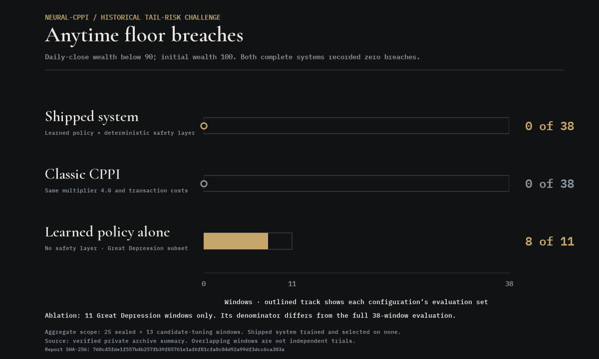
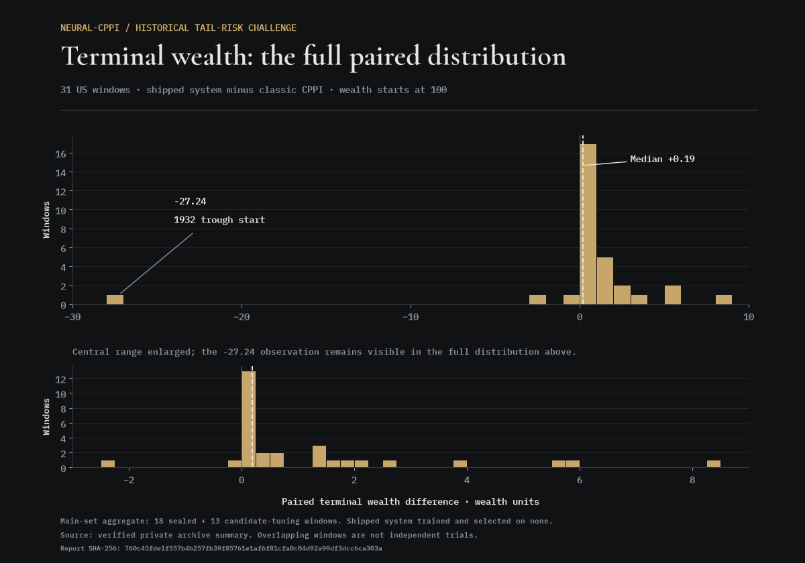

## Historical tail-risk challenge

This pre-registered stress evaluation tested the frozen shipped system on historical crash windows that played no part in training or model selection. The system under test was the learned allocation policy combined with its deterministic safety layer. Its comparator was classic CPPI at the same multiplier, **4.0**, on identical data and transaction costs of **20 bps per unit of turnover**. Initial wealth was **100**, with a floor of **90%** of initial wealth. A breach meant wealth below the floor at any daily close within a window.

The evaluation covered **38 windows**. The main set comprised **31 US windows, 1929–2022**, spanning prolonged collapses, sudden crashes, grinding bear markets, V-shaped shocks and a rate-shock bear market, at horizons of **252 or 504 trading days**. A second set comprised **7 windows** across Japan, Hong Kong, Germany and China. Windows before **1957** used a total-market research series as the index proxy. All windows used daily closes.

The aggregate spans two distinct uses within the improvement program: **25 sealed windows**, comprising **11 test, 7 held-out and 7 international windows**, were evaluated once after the freeze; **13 tuning-tier windows**, comprising **9 validation and 4 layer-tuning windows**, were used only to develop and judge improvement candidates. The shipped system was never trained or selected on any of these windows. On the sealed 25, it recorded **zero breaches**, worst minimum wealth **90.33**, and terminal wealth wins over classic CPPI in **15 of 18 sealed main-set windows** and **6 of 7 international windows**. The 38-window aggregate below is broader than this sealed evaluation.

The shipped system recorded **zero anytime breaches in 38 of 38 windows**, with worst observed minimum wealth **90.33**. **Classic CPPI also recorded zero breaches.** This protection result does not distinguish the shipped system from classic CPPI. On terminal wealth, the shipped system finished ahead in **28 of the 31 main-set windows**, but the typical paired advantage was modest: median **+0.19** wealth units and mean **+0.30**. Half of the wins were by **+0.25 or less**.

In the separate **11-window Great Depression ablation subset**, removing the safety layer left the learned policy with breaches in **8 of 11 windows**. The protection record therefore belongs to the combined policy and safety layer, which is the configuration the repository ships.

The principal limitation was post-trough recovery. In the window starting at the **1932 trough**, classic CPPI reached terminal wealth **153.38**, against **126.14** for the shipped system. Across the recovery windows, classic CPPI held a mean risky weight of **0.500**, against **0.151** for the learned policy. The learned policy does not commit its full permitted budget after a crash.

The windows overlap by construction: paired horizons share start dates. The **38 windows are not 38 independent trials**, and the observed zero-breach record is not a universal floor-protection guarantee.

Four candidate improvements, multi-horizon training, an anytime shortfall penalty, a rebound feature and a recovery spending rule, were tuned only within the separate validation and layer-tuning tiers, frozen, and judged once against sealed windows under a pre-registered adoption rule. None met the rule; the shipped system is unchanged. One early evaluation of the penalty candidate used a mis-signed objective term. It was rerun with the sign corrected under identical budgets, data and seeds, and the rejection stood.

The complete study is retained as a private report. Its record is fixed by SHA-256 `760c45fde1f557b4b257fb39f85761e1af6f81cfa0c04d92a99df3dcc6ca303a`. This section publishes summary results and aggregate charts only.
